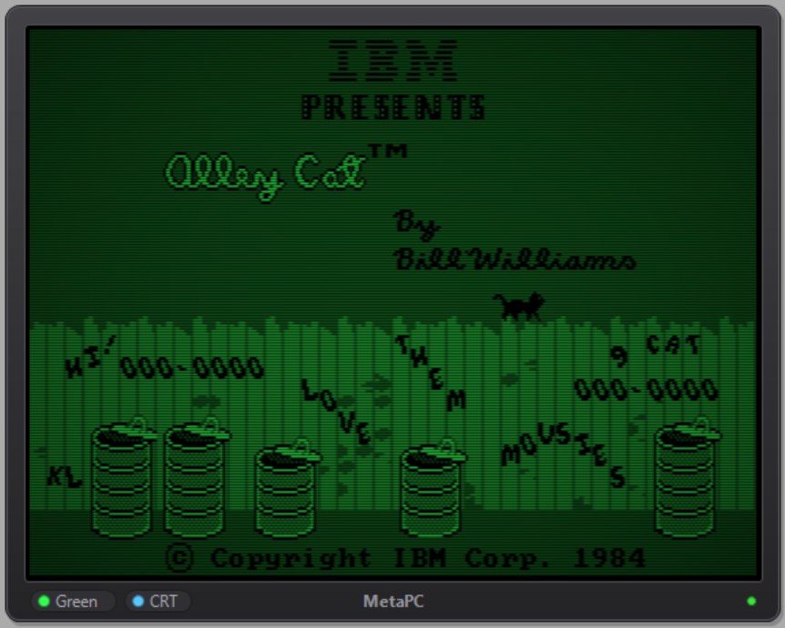
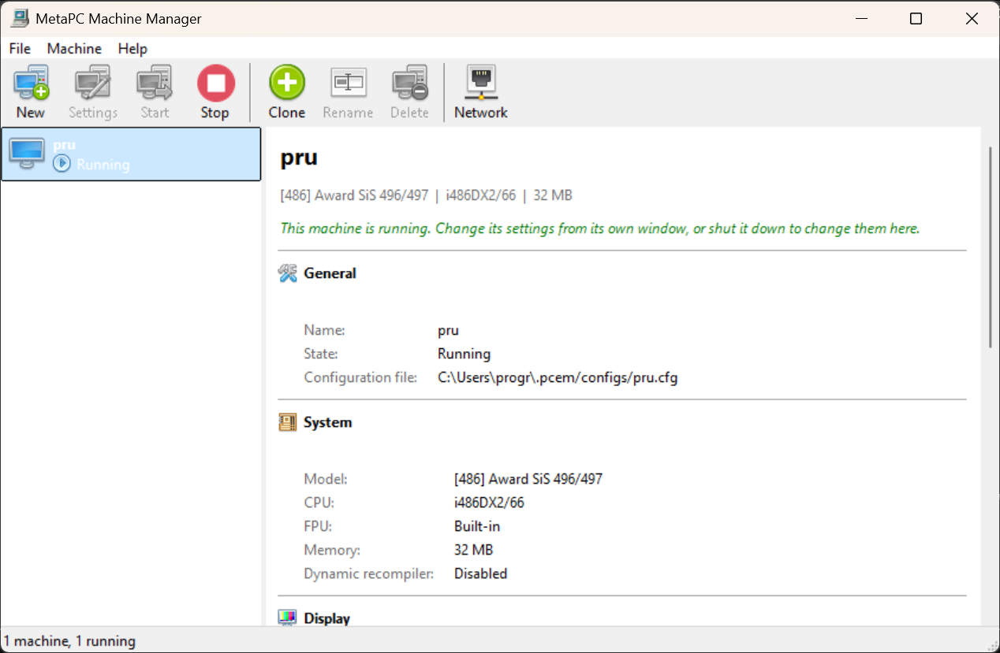
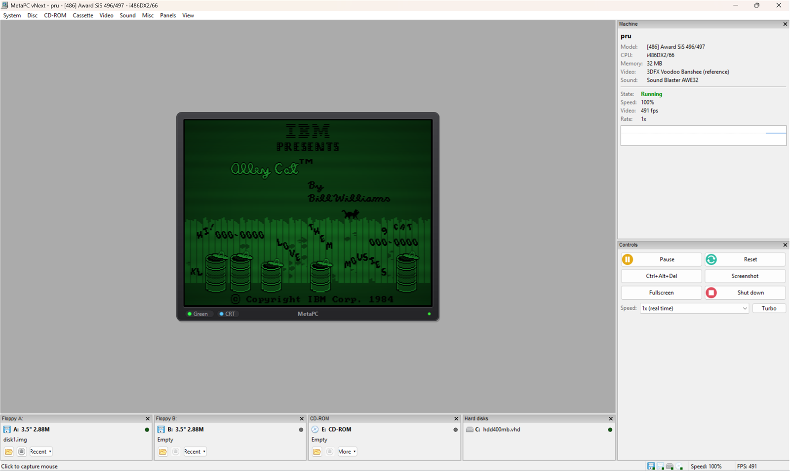

# MetaPC
MetaPC is a fork of [PCem](https://pcem-emulator.co.uk/), the IBM PC emulator.

Copyright (C) 2026 Pedro A. Pelaez for the MetaPC changes. PCem is
Copyright (C) 2007-2020 Sarah Walker and Contributors and Copyright (C) 2021-2026 Michael Manley,
Sarah Walker and Contributors.

MetaPC is an independent project and is not affiliated with or endorsed by the PCem project.



## What's New in MetaPC
MetaPC keeps PCem's emulation core and adds a new interface and several features on top of it.

### Machine Manager


The configuration selection dialog is replaced by a machine manager in the style of VirtualBox:
- A list of machines with their state (powered off, starting, running) and a details pane that
  summarises each machine's hardware.
- New, Settings, Start, Stop, Clone, Rename and Delete commands, plus the host network settings.
- **New** asks for the machine's name and how to set it up: **Classic** (choose the hardware in the
  configuration dialog) or **By motherboard** (start from a real board, see below). New machines start
  from default settings, not from those of the machine shown last.
- The manager stays open while machines run. Each machine runs in its own process, so several
  machines can run at once, and a machine that is already running cannot be started twice.
- **Stop** force-stops a machine that no longer responds, after asking first (its unsaved state is lost).

### Machines from Real Motherboards
**New > By motherboard** creates a machine from a motherboard catalogued on
[The Retro Web](https://theretroweb.com):
- Search by model or part number (without the manufacturer, for example `P55T2P4`). Only boards that
  have BIOS files on The Retro Web are listed.
- Picking a board shows its chipset, Super I/O and other chips, CPU socket, bus speeds, RAM, slots and
  ports, and whether MetaPC can emulate it:
  - **Can be emulated**: MetaPC already emulates that very board. Its own ROM set or one of the board's
    BIOS files can be used.
  - **Can be emulated (experimental)**: MetaPC emulates its chipset, so the board's BIOS runs on a
    MetaPC model with the same chipset (preferring one with the same Super I/O). Warnings say what may
    not work, such as a different Super I/O or onboard video, sound or SCSI that is not emulated.
  - **Cannot be emulated**: the reason, usually a chipset MetaPC does not emulate yet.
- **Use this board** downloads the chosen BIOS, takes it out of its zip (joining the even and odd
  halves of BIOSes that come as two chips) and checks its size and start-up code before using it.
- The configuration dialog then keeps to the board: the model is fixed, and it offers only the CPUs
  for the board's bus speeds, memory up to the board's maximum, and the video, sound, network and disk
  cards made for its slots (8 or 16-bit ISA, VLB, PCI). These limits are saved with the machine and
  still apply in **Settings**.
- A machine can use a BIOS image of its own in place of its model's ROM set; a flash BIOS keeps its
  settings in the machine's own NVR files.

MetaPC includes none of The Retro Web's data. It only contacts the site when you search or pick a
board, waits at least 5 seconds between requests as the site's `robots.txt` asks, and identifies itself
as MetaPC. Boards you look at are cached for 30 days, and downloaded BIOS files are kept, in the `trw`
folder of the data directory. Board data comes from The Retro Web under
[CC BY-SA 4.0](https://creativecommons.org/licenses/by-sa/4.0/), credited in the search window, the
cache files and the machine's details. BIOS images belong to their makers.

### Machine Window


- The emulated screen can be drawn inside a monitor frame, surrounded by dockable panels that can
  be moved, floated or hidden from the **Panels** menu:
  - **Machine**: model, CPU, memory, video and sound cards, state, speed and a speed graph.
  - **Controls**: pause/resume, reset, Ctrl+Alt+Del, screenshot, fullscreen, shut down, speed and turbo.
  - One panel per floppy drive, CD-ROM, ZIP drive and the hard disks, with activity LEDs, load/eject,
    recently used images and drag and drop. The hard disks panel shows each disk's geometry
    (for example `C 306 H 4 S 17`) with a **Copy** button, for BIOSes that need it typed in.
- The panel layout and the window position are saved per machine. Fullscreen hides the panels.
- **Screen filters**: a button on the monitor frame switches between colour (no filter), black and
  white, green phosphor and amber phosphor.
- **CRT effect**: a second button adds scanlines, a slightly softer picture and darker edges. It
  offers a preset for each era of monitors, since later monitors had finer dot pitches and fainter
  scanlines: early (MDA, CGA), EGA / first VGA, VGA (386 and 486) and late SVGA (Pentium). It can
  be combined with any screen filter. Both settings are saved per machine.

### Emulation Speed
- **System > Emulation speed** runs the whole machine (CPU, timers, clock, video) at 1x, 2x, 4x, 8x
  or unlimited speed.
- **Turbo** (Ctrl+Alt+Home) runs at unlimited speed until it is pressed again. Sound is muted
  while the machine runs faster than real time.

### Drive Sounds
A new **Drive sounds** device (Sound tab) plays the noises of the drives. They are synthesised, not
recorded samples:
- Floppy drives: motor, disk friction, head steps, head load and disk insertion, with 5.25" and
  3.5" profiles.
- Hard disks: spin-up, spindle hum and seeks, from old stepper motor MFM drives to 7200 RPM drives.
  The profile is chosen from the controller and the disk size.
- CD/DVD drives: spin-up/spin-down, seeks, tray and audio playback, chosen from the drive model and speed.

### Host CD/DVD Drives
- The host's optical drives are listed with their vendor and model, and the list is refreshed when
  a drive is plugged in or removed (also from **CD-ROM > Refresh host drives**).
- The selected drive is found again at start even if its drive letter changed.
- A new **PCemDVD (DVD-ROM)** drive model, and support for DVD images larger than 4 GB.

### CompactFlash Cards as Hard Disks
- A card in a USB reader (or another removable disk of the host) can be used as a hard disk in place
  of an image file: the card button next to **New** in the hard disk settings lists the cards found.
  The emulated machine reads and writes the card directly, so it can be partitioned, formatted and
  set up in the emulator and then moved to a real machine.
- The card gets the geometry it reports to a BIOS set to auto-detect (16 heads and 63 sectors on cards
  over 504 MB). The **Hard disks** panel of the machine window shows it (for example `C 4066 H 16 S 63`)
  with a **Copy** button, to enter the same values in the BIOS of the real machine.
- On Windows, writing to a card needs administrator rights. MetaPC does not need to run as
  administrator: a machine that uses a card asks for permission (the Windows UAC prompt) when it
  starts, and only that machine's process gets it. If the prompt is declined, the machine starts
  anyway and reports that it cannot open the card.
- If the Windows user is not an administrator, the prompt asks for another account's password and the
  machine runs as that account. It still uses the user's own data folder (ROMs, settings, CMOS), and
  if that account cannot read the folder it says so before the emulator starts.
- The machine manager still shows a machine running with administrator rights as running, and **Stop**
  asks for permission to force-stop it when needed.
- On Linux the card is opened as `/dev/sdX` or `/dev/mmcblkN` (the user needs read and write access to the device, for
  example through the `disk` group). A card that is mounted is refused: unmount it first. Cards are
  not supported on macOS yet.
- The disk that holds the operating system and fixed internal disks are never offered, and are refused
  even if they are typed in by hand.

### Other Changes
- **Random MAC address**: a dice button next to the MAC address field generates a new address.
- **`--data-dir <folder>`** command-line option: uses the given data folder instead of the usual one.
- **Logs in every build**: each process writes a log in the `logs` folder of the data directory
  (`<machine>.log`, or `manager.log` for the manager), so a machine that hangs leaves a trace.
- The memory amount is kept when the machine model changes (an XT's 640 KB no longer becomes 640 MB).
- New AT machines get the Standard IDE controller, and drives cannot be set up while a machine has no
  disk controller (a BIOS could hang looking for a disk that nothing connects).
- Fixed a hang when starting a machine with an IBM PC Fixed Disk Adapter (Xebec) or DTC 5150X hard
  disk controller.

Internal names are unchanged so existing setups keep working: the executable is still `pcem`, the
data folder is still `~/.pcem` and the plugin API is the same.

## Downloads
Ready-to-run packages are published on the [releases page](https://github.com/PSF1/metapc/releases):
- **Linux** x86_64 and aarch64: an AppImage that runs on Ubuntu 20.04 and newer (and other
  distributions of the same age or newer).
- **Windows** x64 and arm64: a zip with `pcem.exe` and the DLLs it needs.
- **macOS** arm64 (Apple Silicon): a zip with `MetaPC.app`. It is not notarised, so the first time it
  has to be opened with right click > **Open**.

Each push to the repository also builds these packages as workflow artifacts in GitHub Actions.

## AI Use
Much of the code added in MetaPC was written with Claude (an AI model made by Anthropic), under
Pedro A. Pelaez's direction and testing. PCem does not accept AI generated or assisted code, so
**do not submit MetaPC changes to the PCem project**.

## License
MetaPC, like PCem, is licensed under GPL v2.0, see [COPYING](COPYING) for more details.

## Patch Submission
Issues and pull requests go to [PSF1/metapc](https://github.com/PSF1/metapc), not to PCem.

## Note about ROM Files
<b>NO COPYRIGHTED ROM FILES ARE INCLUDED NOR WILL THEY BE. PLEASE DO NOT ASK FOR THEM.</b>

## How to Build
You will need the following libraries and buildtools (and their dependencies):
- SDL2
- wxWidgets 3.x (including the aui and net components; on Linux wxWidgets needs libcurl for
  web requests, used by the motherboard search)
- OpenAL
- CMake
- ALSA (Linux only)
- GTK3 Dev Package (Linux only)
- PCap
- LibSlirp
- Ninja (Recommended, but you can use a Makefile generator if you prefer)

Open a terminal window, navigate to the MetaPC directory, create a build directory, then enter in that build directory: 
```
cmake -G "Ninja" -DCMAKE_BUILD_TYPE=Release ..
ninja
```

then `./src/pcem` to run on most platforms, and open `./src/MetaPC.app` on macOS

BIOS ROM images, configuration files, and other data are stored in `~/.pcem` on non-macOS platforms. You can also create a `.pcem` folder with
the Binary, and run it in a portable mode.

The configure options are specified below. They are in the format of -D`Option`=`Value`. `Value` under here is the
default value.
```
  -DCMAKE_BUILD_TYPE=Release : Generate release build. Recommended for regular use.
  -DCMAKE_BUILD_TYPE=Debug   : Compile with debugging enabled.
  -DPCEM_DISPLAY_ENGINE=wxWidgets : Compile with the WxWidgets Display Engine. Default
  -DPCEM_DISPLAY_ENGINE=SDL  : Compile with the SDL Display Engine. This is more of a sample for additional GUI's but is here for postarity.
  -DUSE_NETWORKING=ON        : Build with networking support.
  -DUSE_PCAP_NETWORKING=ON   : Build with pcap networking support. (Needs USE_NETWORKING to compile) Requires libpcap.
  -DFORCE_X11=ON             : Enables a hack to force X11 on Wayland systems. See #128 for details. (Linux Only)
  -DPLUGIN_ENGINE=ON         : Build with plugin support. Builds libpcem-plugin-api and links MetaPC with it.
  -DPCEM_MARCH=x86_64-v2     : Change the architecture used for generated instructions, by default we set it for
                               >= Nehalem for Intel, and >= Bulldozer for AMD. 
```

If you are using -DCMAKE_BUILD_TYPE=Debug, there are some more debug options you can enable if needed
```
  -DPCEM_SLIRP_DEBUG=OFF           : Build MetaPC with SLIRP_DEBUG debug output
  -DPCEM_RECOMPILER_DEBUG=OFF      : Build MetaPC with RECOMPILER_DEBUG debug output
  -DPCEM_NE2000_DEBUG=OFF          : Build MetaPC with NE2000_DEBUG debug output
  -DPCEM_EMU8K_DEBUG_REGISTERS=OFF : Build MetaPC with EMU8K_DEBUG_REGISTERS debug output
  -DPCEM_SB_DSP_RECORD_DEBUG=OFF   : Build MetaPC with SB_DSP_RECORD_DEBUG debug output
  -DPCEM_MACH64_DEBUG=OFF          : Build MetaPC with MACH64_DEBUG debug output
  -DPCEM_DEBUG_EXTRA=OFF           : Build MetaPC with DEBUG_EXTRA debug output
```

If you are using -DCMAKE_BUILD_TYPE=RelWithDebInfo, there are additional options you can do
```
  -DPCEM_RELDEB_AS_RELEASE=ON     : Builds RelWithDebInfo with debugging logging enabled when this is off
```

They are some extra modules you can add if you build with `-DUSE_EXPERIMENTAL=ON`. These modules are untested.
incomplete, and may or may not be in a future build of MetaPC. We do not provide builds with these enabled as
well. It is also possible they may not even build.
```
  -DUSE_EXPERIMENTAL_PGC=ON       : Build MetaPC with Professional Graphics Controller support.
  -DUSE_EXPERIMENTAL_PRINTER=ON   : Build MetaPC with Printer support. Requires freetype.
``` 

On Windows, if you want to use PCAP networking, you will need to install [npcap](https://npcap.com) and replace the libpcap.dll in the MetaPC dir using the wpcap.dll installed in C:\Windows\System32  

## Links

### [MetaPC emulates the following hardware](SYSTEMS.md):
Hardware | Links
--- | ---
Systems | [8088](SYSTEMS.md#8088-based)<br/>[8086](SYSTEMS.md#8086-based)<br/>[286](SYSTEMS.md#286-based)<br/>[386](SYSTEMS.md#386-based)<br/>[486](SYSTEMS.md#486-based)<br/>[Pentium](SYSTEMS.md#pentium-based)<br/>[Super Socket 7](SYSTEMS.md#super-socket-7-based)
Graphics | [Basic](SYSTEMS.md#basic-cards)<br/>[Unaccelerated (S)VGA cards](SYSTEMS.md#unaccelerated-svga-cards)<br/>[2D accelerated SVGA cards](SYSTEMS.md#2d-accelerated-svga-cards)<br/>[3D accelerated SVGA cards](SYSTEMS.md#3d-accelerated-svga-cards)<br/>[3D only cards](SYSTEMS.md#3d-only-cards)
Sound | [Cards](SYSTEMS.md#sound-cards)
HDD Controller | [Cards](SYSTEMS.md#hdd-controller-cards)
Misc | [Cards](SYSTEMS.md#misc-cards)

### [Software Tested](TESTED.md):
- [DOS](TESTED.md#dos)<br/>
- [Windows](TESTED.md#windows)<br/>
- [Windows NT](TESTED.md#windows-nt)<br/>
- [OS/2](TESTED.md#os2)<br/>
- [Linux](TESTED.md#linux)<br/>
- [Applications](TESTED.md#applications)<br/>
- [Games](TESTED.md#games)<br/>
- [Demos](TESTED.md#demos)<br/>
- [Emulators](TESTED.md#emulators)<br/>
